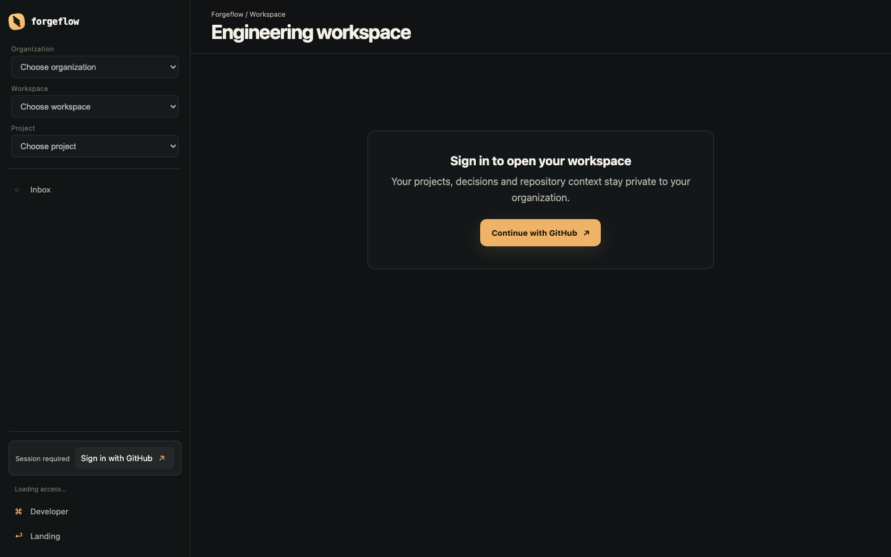
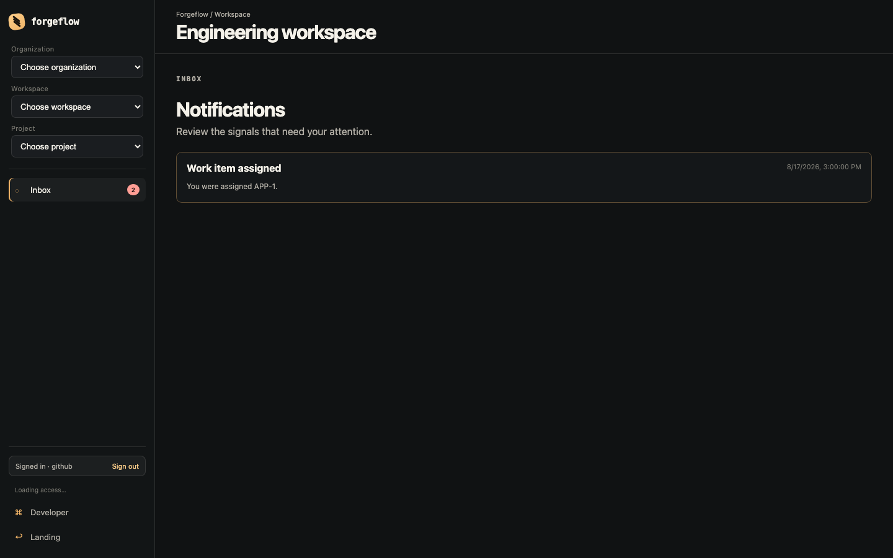

# Hướng dẫn sử dụng Forgeflow

Forgeflow giúp đội engineering đi từ một yêu cầu ban đầu đến thay đổi đã được review:

~~~text
Yêu cầu → Work Item → Definition rõ ràng → Human review → READY
→ Code/Agent → Pull Request → Code review → QA → DONE

Project nào bật release governance sẽ tiếp tục qua `READY_FOR_RELEASE`
→ `DEPLOYING` → `PRODUCTION_VERIFY` → `DONE`.
~~~

Nếu mới dùng, chỉ cần đi theo luồng này:

1. Đăng nhập bằng GitHub.
2. Chọn đúng Organization → Workspace → Project.
3. Kết nối GitHub App và link repository vào Project.
4. Tạo Work Item.
5. Bổ sung Definition cho đến khi readiness pass.
6. Human review rồi chuyển item sang `READY`.
7. Thực hiện bằng developer, Desktop Agent Runner, Autonomous hoặc MCP.
8. Review code, kiểm tra QA và hoàn tất item.

Production: [forgeflow.vincent2k2.id.vn](https://forgeflow.vincent2k2.id.vn/app)
Local development: `http://localhost:13000/app`

> Tài liệu này giải thích cách dùng toàn bộ hệ thống. Xem [Backlog workflow playbook](backlog-workflow.md) khi cần quy trình chi tiết hoặc quy tắc nâng cao.

## 1. Hiểu nhanh các khái niệm

| Khái niệm | Hiểu đơn giản | Ví dụ |
| --- | --- | --- |
| **Organization** | Tổ chức sở hữu dữ liệu | `Forgeflow` |
| **Workspace** | Không gian làm việc trong organization | `Main workspace` |
| **Project** | Phạm vi của sản phẩm, backlog và quyền | `APP · Application` |
| **Repository** | Repository GitHub chứa source code | `acme/forgeflow-web` |
| **Work Item** | Một việc cần xử lý | `APP-42 · Fix invoice PDF` |

Project là ranh giới quan trọng nhất. Backlog, board, repository link, workflow, thành viên và quyền đều phụ thuộc vào Project đang chọn. Không nên tạo Work Item ở Project này rồi dùng repository hoặc context của Project khác.

## 2. Bắt đầu từ đâu?

### 2.1. Đăng nhập

1. Mở Forgeflow.
2. Chọn **Continue with GitHub** hoặc **Sign in with GitHub**.
3. Hoàn tất xác thực.
4. Mở `/app`.

Khi chưa đăng nhập, project picker bị khóa và có thể hiển thị **Sign in to open your workspace**. Đây là cơ chế bảo vệ dữ liệu, không phải lỗi ứng dụng.

### 2.2. Chọn đúng Project

Mở **Project switcher** rồi chọn option có đủ Organization / Workspace / Project. Khi đổi Project, Forgeflow sẽ tải lại context, quyền và backlog. Trong lúc tải:

- hiển thị **Loading project…**;
- project switcher tạm thời bị khóa;
- dữ liệu của Project cũ không được giữ lại trên màn hình.

Nếu yêu cầu chưa nói rõ Project, hãy dừng lại và hỏi người yêu cầu. Không tự đoán dựa vào tên gần giống.

### 2.3. Kết nối GitHub và link repository

Đăng nhập GitHub và cấp quyền đọc repository là hai việc khác nhau:

| Việc | Mục đích |
| --- | --- |
| **Sign in with GitHub** | Xác định người dùng và tạo session Forgeflow |
| **Connect GitHub / GitHub App** | Cho Forgeflow quyền nhìn thấy repository |
| **Link to project** | Chọn repository nào thuộc Project hiện tại |

Thao tác chuẩn:

1. Mở **Repositories** trong Project.
2. Bấm **Connect GitHub**.
3. Cài hoặc cập nhật Forgeflow GitHub App.
4. Chọn account/organization và repository được phép dùng.
5. Bấm **Refresh** nếu danh sách chưa cập nhật.
6. Bấm **Link to project**.
7. Kiểm tra card repository đã hiện **Linked**.

MCP và Work Item chỉ được dùng repository đã link. Repository chưa link sẽ không được tự động suy ra hoặc thay thế bằng một thư mục local.

## 3. Mỗi khu vực trong hệ thống dùng để làm gì?

| Khu vực | Dùng khi nào |
| --- | --- |
| **Backlog** | Tạo, tìm, lọc và theo dõi Work Item |
| **Board** | Nhìn công việc theo các cột workflow và chuyển status |
| **Planning** | Sprint, milestone và kế hoạch ưu tiên |
| **Repositories** | Kết nối GitHub, link/unlink repo và xem engineering context |
| **Inbox** | Đọc notification và mở lại item cần xử lý |
| **Project settings** | Workflow, Board, Branching, Delivery policy, People, Custom fields, Automation |
| **Organization/Workspace settings** | Thành viên và cấu hình ở scope lớn hơn |
| **Developer** | PAT và kết nối MCP |
| **Desktop Agent Runner** | Tạo worktree local, review diff và chạy agent đã approve |

UI có thể ẩn hoặc disable action khi bạn thiếu quyền, nhưng backend vẫn kiểm tra quyền cho từng request. Nếu một nút không xuất hiện, trước tiên kiểm tra Project và role hiện tại.

## 4. Tạo và làm rõ Work Item

### 4.1. Tạo item

Trong **Backlog**:

1. Bấm **+ New work item**.
2. Nhập **Title** ngắn, mô tả kết quả cần đạt.
3. Chọn **Type**: Task, Story, Bug, Epic hoặc Sub-task.
4. Nhập **Context**: vì sao việc này cần làm hoặc signal ban đầu.
5. Bấm **Create work item**.

Ví dụ title tốt:

~~~text
Hiển thị loading khi người dùng đổi Project
Không tạo invoice PDF khi đơn hàng có nhiều item
Thêm endpoint xem trạng thái payment cho mobile app
~~~

Context ban đầu chưa cần hoàn hảo. Sau khi tạo, mở tab **Definition** để làm rõ.

### 4.2. Điền Definition

Definition trả lời câu hỏi: “Người khác có thể thực hiện và kiểm tra việc này mà không phải đoán không?”

Với **Bug**, cần có:

- vấn đề thực tế;
- cách tái hiện;
- kết quả mong đợi và kết quả thực tế;
- môi trường xảy ra lỗi;
- component bị ảnh hưởng;
- acceptance criteria;
- repository liên quan hoặc lý do no-code.

Với **Task/Story**, cần có:

- goal hoặc outcome;
- phạm vi và ràng buộc;
- component/repository bị ảnh hưởng;
- acceptance criteria;
- test plan hoặc Definition of Done.

Các gap như `GOAL_OR_PROBLEM_STATEMENT`, `ACCEPTANCE_CRITERION` và `REPOSITORY_OR_NO_CODE_CHANGE_RATIONALE` là lời nhắc cần bổ sung, không phải lỗi hệ thống.

Mỗi lần sửa Definition sẽ tạo version mới. Hãy bấm **Mark human verified** cho các field bạn đã kiểm tra, sau đó bấm **Review specification**. AI proposal chỉ là gợi ý, chưa phải sự thật đã xác minh.

## 5. Làm việc với Backlog và Board

### List view

Trong **Backlog**, bạn có thể:

- tìm theo title hoặc context;
- lọc theo Status, Type, Priority;
- mở detail drawer bằng cách bấm vào row;
- dùng **Load more** để xem trang tiếp theo;
- chuyển sang **Board**.

Mặc định Backlog chỉ hiển thị công việc chưa ở terminal status để giữ danh sách tập trung vào việc đang xử lý. Chọn `DONE` hoặc status terminal trong bộ lọc để xem lại công việc đã hoàn tất; Board vẫn giữ cột `DONE` để theo dõi luồng.

Filter được lưu trong URL nên có thể copy cho đồng đội, ví dụ:

~~~text
/backlog?view=board&q=invoice&status=REFINING
~~~

### Board view

Board hiển thị Work Item theo các cột workflow. Có thể kéo card khi transition được phép. Nếu board báo stale/conflict, bấm **Reload board** trước khi thử lại.

Muốn Board tự ẩn card đã hoàn tất sau một khoảng thời gian, vào **Project settings → Board** và chọn **Never**, `7`, `14`, `30` hoặc `60` ngày. Card vẫn tồn tại và tìm kiếm được; chỉ projection trên Board bị ẩn. Mốc tính là `completed_at`, nên việc sửa title hoặc metadata sau khi Done không làm thời hạn bị kéo dài.

Tên status phụ thuộc workflow của Project. Một luồng minh họa là:

~~~text
RAW → REFINING → REVIEW_REQUIRED → READY → IN_PROGRESS
→ CODE_REVIEW → QA → DONE
~~~

Không đổi status bằng update metadata chung. Mọi status change phải đi qua transition của server, có quyền và version hiện tại.

### Work Item detail

Drawer hoặc full page thường có:

- **Overview**: status, priority, version, repository và next action;
- **Definition**: specification, readiness và human verification;
- **Activity**: comment, audit và context trao đổi.

Nếu người khác cập nhật item trong lúc bạn đang mở, server có thể từ chối thao tác stale version. Hãy reload rồi kiểm tra lại trước khi sửa tiếp.

`RAW` chỉ là trạng thái tiếp nhận ban đầu: hãy dùng transition refinement đã cấu hình trước khi agent hoặc người dùng bổ sung, sửa và xác minh Definition. Agent/autonomous bắt đầu từ `RAW` sẽ tự chọn transition refinement của Project; việc review toàn bộ specification chỉ hợp lệ ở status review do workflow cấu hình (mặc định là `REVIEW_REQUIRED`).

### Branch plan và branch động

Trong **Project settings → Branching**, manager cấu hình branch matrix theo loại `feature`, `fix`, `refactor`, `chore`, `hotfix` và `release`: base/target role, ephemeral hoặc managed branch, tạo PR và sync bắt buộc. Server vẫn giữ invariant an toàn: branch làm việc dùng tiền tố `forgeflow/`, hotfix đi từ production và phải sync về development, còn release là branch manager tạo theo prefix `release/` và đi qua PR tới production.

Ở Work Item → **Branch plan**, người có `branch.manage` có thể preview rồi **Prepare branches**. Nếu development/production branch đã cấu hình nhưng chưa tồn tại, Forgeflow tự tạo chúng từ default branch của repository; release branch do manager chỉ định vẫn phải tồn tại trước. Khi bắt đầu work, server snapshot immutable plan gồm base SHA, base/target/working branch và sync policy; đổi policy sau đó không làm thay đổi item đang chạy. Branch/PR/sync operation có idempotency và retry an toàn. Merge production, merge release và deploy vẫn là human gate; webhook chỉ cập nhật trạng thái merge để workflow kiểm tra.

### Release governance theo Project

Mặc định `DONE` chỉ có nghĩa là development work đã hoàn tất; nó không khẳng định đã deploy production. Project manager có thể vào **Project settings → AI autonomous → Delivery policy**, chọn **Release-gated** hoặc bấm **Install release workflow**. Khi đó server áp dụng chuỗi:

~~~text
QA → READY_FOR_RELEASE → DEPLOYING → PRODUCTION_VERIFY → DONE
                         ↘ ROLLED_BACK khi release/deploy/verify thất bại
~~~

Gate release kiểm tra lại PR và head SHA hiện tại, tất cả required CI checks, reviewer độc lập, các regression case `REQUIRED` đều `PASS` trên đúng commit, PR đã merge, human release approval, deployment success và human production verification. Không có đường tắt từ UI/MCP để tự approve hoặc tự deploy production.

Delivery policy hỗ trợ:

- `LOW` / `NORMAL` / `HIGH` / `CRITICAL` cho từng Work Item;
- số approval tối thiểu và role reviewer bắt buộc;
- path rule dạng `glob | minimum approvals | roles`, ví dụ `payments/** | 2 | security_reviewer`;
- danh sách check CI bắt buộc theo đúng tên check và head SHA;
- rollback plan phải được human verify trước các gate tương ứng.

Với hotfix, dùng branch plan đã cấu hình: branch từ production SHA → PR production → deploy/verify → tạo sync-backport về development. Work Item có branch plan yêu cầu sync sẽ không thể chuyển terminal `DONE` cho đến khi PR sync về development được webhook ghi nhận là `MERGED`.

## 6. Từ READY đến code được review

Chỉ bắt đầu thực hiện khi:

- readiness đã pass;
- human đã review đúng specification version;
- repository và base commit đã xác định;
- acceptance criteria và test plan đủ rõ.

Bạn có ba cách thực hiện:

| Cách | Repository nằm ở đâu? | Khi nào dùng? |
| --- | --- | --- |
| Developer thủ công | Máy developer | Thay đổi nhỏ hoặc cần kiểm soát trực tiếp |
| Desktop Agent Runner | Local worktree do app quản lý | Muốn agent sửa code nhưng vẫn inspect/approve từng bước |
| Autonomous server | Workspace cách ly được clone từ GitHub | Muốn chạy agent server theo policy và AgentRun |

### Desktop Agent Runner

Flow gồm bốn bước:

1. **Choose local code folder** — chọn folder code, tìm các Git repository bên trong và chọn project local.
2. **Create managed worktree** — tạo worktree và branch riêng.
3. **Inspect and hand off** — xem diff, rồi mới commit hoặc push.
4. **Run the approved agent** — chọn Codex/Claude, nhập prompt và xác nhận approval.

Đường dẫn project local được lưu trong `localStorage` của Desktop theo từng máy. Agent không tự merge. Trước khi push, kiểm tra diff, secret, file ngoài phạm vi, branch `forgeflow/*` và commit subject theo Conventional Commits.

#### Clone repository private qua Forgeflow

Nếu repository chưa có trong folder code local, mở **Clone project qua Forgeflow** trong bước Repository:

1. Nhập API URL, `Project ID`, `Repository ID` và tên folder local.
2. Bấm **Authorize GitHub code** rồi cấp quyền cho đúng tài khoản GitHub.
3. Bấm **Clone repository**.

Luồng này dùng GitHub App user authorization của Forgeflow. Repository private chỉ clone/push được khi GitHub App đã được cài vào account/organization, repository đã được chọn trong installation, user có quyền trên repository và App có permission `Contents: Read` (clone) hoặc `Contents: Read and write` (push). Quyền thực tế là phần giao nhau giữa quyền của App và tài khoản user.

Token code được Forgeflow mã hóa ở backend, cấp ngắn hạn cho Desktop main khi clone/push và không lưu trong renderer hoặc `localStorage`. Cấu hình backend cần dùng client ID/secret của chính GitHub App (không phải OAuth App dùng cho Sign in), callback URL `/api/v1/integrations/github/user/callback`, khóa mã hóa 32 byte và migration mới nhất:

~~~sh
export FORGEFLOW_GITHUB_APP_CLIENT_ID='...'
export FORGEFLOW_GITHUB_APP_CLIENT_SECRET='...'
export FORGEFLOW_GITHUB_APP_USER_CALLBACK_URL='https://forgeflow.example.com/api/v1/integrations/github/user/callback'
export FORGEFLOW_GITHUB_APP_TOKEN_ENCRYPTION_KEY="$(openssl rand -base64 32)"
make migrate-up
~~~

MCP vẫn chỉ đọc GitHub. Tạo branch, sửa code, commit và push phải đi qua Desktop Agent Runner và hành động human-approved.

### Autonomous server

Ở Work Item → **Runs**:

1. Kiểm tra repository và specification.
2. Bấm **Start autonomous**.
3. Chọn Codex hoặc Claude.
4. Viết objective và test scope.
5. Theo dõi các gate `Specification`, `Executing`, `Test feedback`, `PR review`.

Nếu specification chưa được review, run dừng ở `WAITING_SPEC_REVIEW`. Khi retry, case đã `PASS` được giữ lại; chỉ case unresolved được đưa vào attempt mới.

Server runner phải được xem là môi trường thực thi code không tin cậy. Docker runner mặc định dùng root filesystem read-only, user không phải root, drop toàn bộ Linux capabilities, `no-new-privileges`, workspace duy nhất được mount ghi, `/tmp` có `noexec,nosuid`, CPU/RAM/PID/timeout bounded và output redacted. Network mặc định `none`; nếu provider cần gọi API, chỉ bật `bridge` trong mạng egress đã bị firewall/allowlist kiểm soát. Image phải dùng tag version cố định hoặc digest, không dùng `latest`. `FORGEFLOW_RUNNER_DOCKER_WORKSPACE_ROOT` phải là đường dẫn tuyệt đối mà Docker daemon nhìn thấy. Mount Docker socket cho runner có quyền gần tương đương root; production nên đặt runner trên host/VM riêng hoặc dùng daemon/rootless boundary.

## 7. Dùng MCP với toàn bộ Project

MCP là kết nối organization-wide để Codex, Claude hoặc Cursor gọi Forgeflow. Một kết nối dùng được cho nhiều Project; nếu yêu cầu chưa rõ Project, MCP phải gọi danh sách Project và hỏi lại.

### Kết nối

1. Vào **Developer → Kết nối MCP**.
2. Chọn Codex, Cursor hoặc Claude.
3. Bấm **Tạo kết nối**.
4. Lưu token và cấu hình được sinh ra; token chỉ hiện một lần.

Với Codex, cấu hình có dạng:

~~~sh
export FORGEFLOW_MCP_TOKEN='TOKEN_DUOC_CAP_MOT_LAN'
codex mcp add forgeflow \
  --url "https://forgeflow.example.com/api/v1/mcp" \
  --bearer-token-env-var FORGEFLOW_MCP_TOKEN
~~~

Docker local dùng endpoint `http://localhost:18080/api/v1/mcp`.

### MCP đọc và thao tác gì?

- đọc thông tin, tree, file, symbol và lịch sử của repository GitHub đã link;
- tìm code trực tiếp trên default branch của GitHub;
- theo dõi AgentRun/Autonomous khi người dùng có quyền;
- không đọc thư mục local làm nguồn code MCP;
- không tạo branch, sửa code, commit, push hoặc Pull Request trên GitHub;
- không tự bỏ qua human review hoặc tự approve production deployment.

Ví dụ khi chưa rõ Project:

~~~text
Tìm nơi xử lý đăng nhập GitHub.
~~~

MCP phải hỏi:

~~~text
Bạn muốn thao tác trong Project nào? Tôi thấy APP, BILLING và WEB.
~~~

Ví dụ đã rõ context:

~~~text
Trong Project BILLING, repository billing-api, tìm code tạo invoice PDF,
đọc file liên quan trên GitHub và giải thích luồng xử lý. Chỉ đọc, chưa tạo PR.
~~~

MCP chỉ đọc GitHub và hỗ trợ ngữ cảnh Work Item. Muốn sửa code, mở Desktop Agent Runner để chạy trên project local; MCP không tự tạo branch, commit, push hoặc PR trên GitHub.

Nếu cần hướng dẫn MCP chi tiết hơn, xem [MCP usage guide](backlog-workflow.md#72-dùng-mcp-từ-codex-claude-hoặc-cursor).

## 8. Review, QA và hoàn tất

Khi có diff hoặc Pull Request:

1. Đọc diff theo từng acceptance criterion.
2. Kiểm tra test case `PASS`, `FAIL`, `BLOCKED`, `NOT_RUN`.
3. Đọc CI result và các feedback liên quan.
4. Nếu cần sửa, dùng **Request changes** hoặc tạo follow-up.
5. Khi CI pass, chuyển sang QA theo workflow.
6. Với workflow mặc định, chỉ chuyển `DONE` khi acceptance criteria và human verification đã hoàn tất; đây là hoàn tất development.
7. Với workflow release-gated, chỉ chuyển `READY_FOR_RELEASE`, `DEPLOYING`, `PRODUCTION_VERIFY` và `DONE` khi gate tương ứng pass; lỗi release/deploy/verify đi qua `ROLLED_BACK` và rollback plan.

`FAIL` và `BLOCKED` phải có note. Không đánh dấu `PASS` chỉ vì build thành công nếu chưa kiểm tra hành vi yêu cầu.

Lưu ý: **xác minh test case trong Definition** là việc người dùng xác nhận scenario/expected result trước khi request review; còn **ghi PASS/FAIL/BLOCKED** là kết quả chạy test, chỉ mở khi AgentRun đã tới `TESTING`, `REVIEWING` hoặc `COMPLETED`.

## 9. Planning, Inbox và Settings

### Planning

Mở **Planning** để xem sprint, milestone và priority planning. Daily execution vẫn nên ở Backlog/Board.

### Inbox

Badge **Inbox** cho biết có notification chưa đọc:

1. Mở **Inbox**.
2. Đọc title, body và thời gian.
3. Mở Work Item liên quan.
4. Đánh dấu notification đã đọc sau khi xử lý.

### Settings

- **Project settings**: Workflow, Board, Branching, Delivery policy, People, Custom fields, Automation.
- **Workspace settings**: thành viên và cấu hình workspace.
- **Organization settings**: thành viên và cấu hình organization.
- **Developer**: PAT và MCP connection.

Quyền ở scope lớn hơn không tự động có nghĩa là bạn có mọi quyền ở Project. Nếu không thấy action, kiểm tra đúng scope và role.

## 10. Ví dụ hoàn chỉnh

### Ví dụ A — Bug tạo invoice PDF bị lỗi

1. Chọn `BILLING` Project.
2. Trong **Repositories**, link `billing-api`.
3. Tạo Bug: `Không tạo invoice PDF khi đơn hàng có nhiều item`.
4. Ghi reproduction: tạo order có 20 item rồi bấm Export PDF.
5. Ghi expected: file PDF được tạo và tải xuống.
6. Ghi actual: request trả `500`, không có file.
7. Thêm acceptance criteria:
   - order nhiều item vẫn tạo được PDF;
   - lỗi được hiển thị rõ nếu renderer thất bại;
   - có regression test cho 1, 20 và 100 item.
8. Mark human verified → Review specification → chuyển `READY`.
9. Tạo AgentRun hoặc giao developer.
10. Review diff, CI, QA rồi mới chuyển `DONE`.

### Ví dụ B — Task thay đổi frontend

~~~text
Project APP, repository forgeflow-web.
Khi đổi Project, hiển thị loading, khóa project switcher,
không hiển thị dữ liệu của Project cũ và có nút Retry khi request lỗi.
Thêm regression test cho loading, error và stale context.
~~~

### Ví dụ C — Việc không sửa code

~~~text
Đây là việc cập nhật quy trình vận hành, không thay đổi source code.
Kết quả hoàn thành là tài liệu được team phê duyệt và thông báo tới người dùng.
Không cần repository context.
~~~

Ghi lý do no-code vào Definition thay vì link một repository không liên quan.

## 11. Lỗi thường gặp

| Hiện tượng | Cách xử lý |
| --- | --- |
| Không thấy Project | Kiểm tra Organization, Workspace và quyền thành viên |
| `Context not found` | Quay về `/app`, rồi chọn lại đúng hierarchy |
| Không thấy repository | Kiểm tra GitHub App, repository selection và **Refresh** |
| Repository chưa link | Vào **Repositories** → **Link to project** |
| `project_id is required` từ MCP | Nói rõ Project hoặc yêu cầu MCP liệt kê Project |
| `forbidden` | Kiểm tra role, capability và token |
| Board không lưu | Bấm **Reload board**, vì có thể item đã đổi version |
| `Not ready` hoặc còn gaps | Bổ sung Definition và human verification |
| Không thấy code mới | MCP chỉ đọc default branch trên GitHub; kiểm tra project local, diff và trạng thái push trong Desktop Runner |
| AgentRun bị gián đoạn | Kiểm tra trạng thái run trước khi chạy lại để tránh duplicate |
| Trang không tải | Bấm **Retry**, refresh cứng và kiểm tra health/deployment |

Khi báo lỗi cho người vận hành, gửi URL, thao tác vừa thực hiện, thời điểm và request ID. Không gửi PAT, MCP token hoặc secret.

## 12. Checklist hằng ngày

### Trước khi làm việc

- [ ] Đúng Organization → Workspace → Project.
- [ ] Repository đã được Connect GitHub và Link đúng Project.
- [ ] Work Item có title, context và type rõ ràng.

### Trước khi chuyển READY

- [ ] Definition đủ goal/problem và acceptance criteria.
- [ ] Có repository liên quan hoặc no-code rationale.
- [ ] Các field quan trọng đã human verified.
- [ ] Readiness pass và đúng specification version.

### Trước khi chạy agent hoặc push code

- [ ] Repository, branch và base commit đúng.
- [ ] Branch plan đã được prepare và branch/target đúng với Work Item.
- [ ] Prompt có phạm vi, test và tiêu chí hoàn thành.
- [ ] Diff không có secret hoặc file ngoài phạm vi.
- [ ] Approval vẫn còn hợp lệ sau các thay đổi input.
- [ ] Đã biết cách review, rollback hoặc retry.
- [ ] Đã chọn risk level phù hợp và biết policy review/CI/QA tương ứng.

### Trước khi hoàn tất

- [ ] Acceptance criteria đã được kiểm tra.
- [ ] CI và regression cases đã được review.
- [ ] Pull Request đã được review.
- [ ] QA pass.
- [ ] Có human approval cho bước production nếu cần.
- [ ] Server runner có workspace riêng, network egress phù hợp, không có production secret và có rollback plan nếu thay đổi rủi ro cao.

## 13. Đường dẫn thường dùng

| Route | Mục đích |
| --- | --- |
| `/app` | Chọn Project/context |
| `/app/orgs/:orgID/workspaces/:workspaceID/projects/:projectID/backlog` | Backlog List/Board |
| `/app/orgs/:orgID/workspaces/:workspaceID/projects/:projectID/repositories` | GitHub repositories |
| `/app/orgs/:orgID/workspaces/:workspaceID/projects/:projectID/settings/:section` | Project settings |
| `/app/orgs/:orgID/settings/:section` | Organization settings |
| `/app/inbox` | Notifications |
| `/app/account/developer` | PAT và MCP |

## 14. Nguyên tắc cần nhớ

1. Chọn đúng Project trước khi thao tác.
2. Link đúng GitHub repository, không dùng repository “gần giống tên”.
3. Definition phải đủ rõ trước automation.
4. AI đưa ra đề xuất; con người xác minh.
5. Status và permission do server quyết định.
6. Review diff, commit, Pull Request và QA là các bước riêng.
7. Không auto-merge hoặc auto-approve production.
