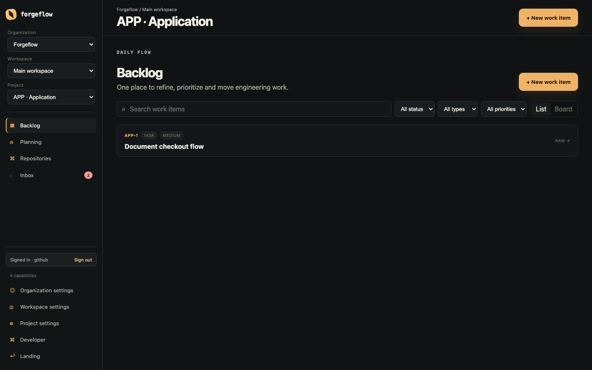
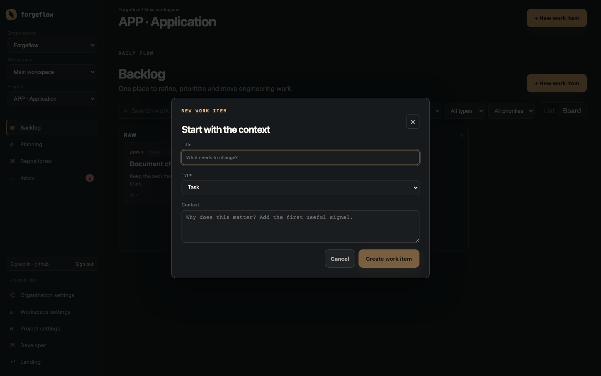
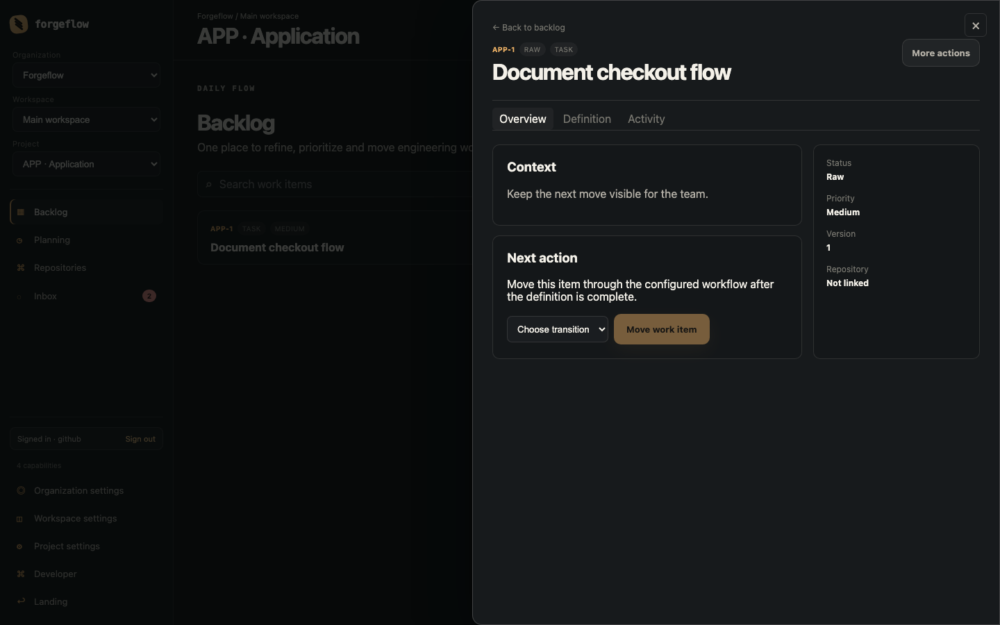
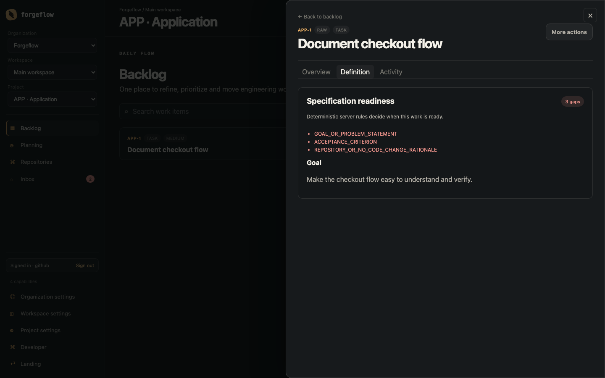
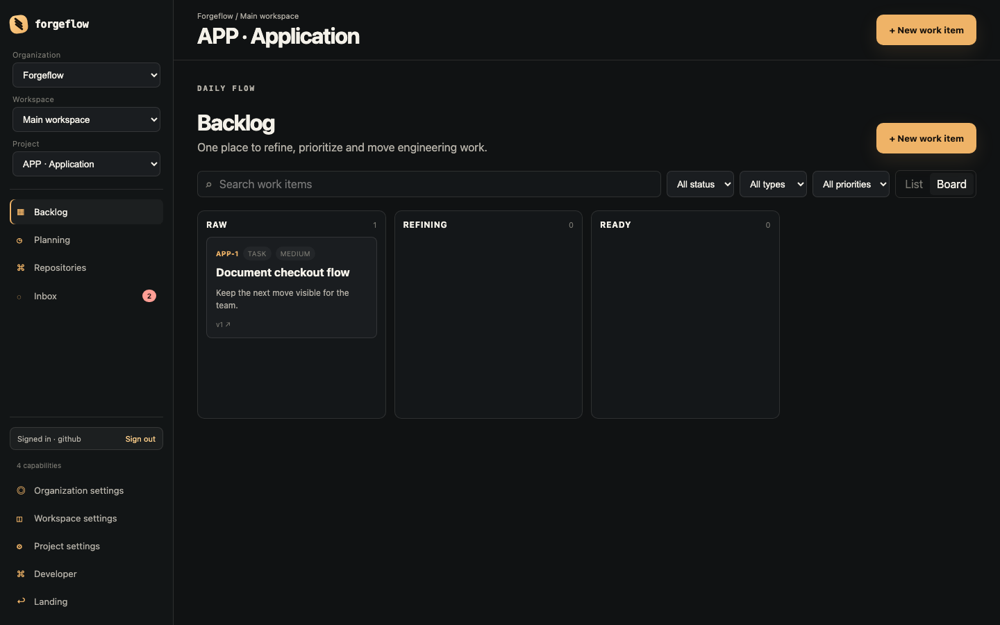

# Backlog workflow: từ yêu cầu đến code được review

Tài liệu này giải thích **khi nào dùng Backlog, tạo Work Item ra sao, gắn repository vào Project như thế nào và lúc nào nên chuyển sang Desktop Agent Runner**.

Backlog không chỉ là danh sách task. Đây là luồng kiểm soát một yêu cầu từ lúc mới phát sinh cho đến khi đủ rõ để người hoặc agent thực hiện:

~~~mermaid
flowchart LR
    A[Request / bug signal] --> B[Chọn đúng Project]
    B --> C[Gắn repository hoặc ghi rõ no-code]
    C --> D[Tạo Work Item]
    D --> E[Bổ sung specification]
    E --> F{Readiness đạt?}
    F -- Chưa đạt --> E
    F -- Đạt --> G[Human review]
    G --> H[READY]
    H --> I[AgentRun / thực hiện code]
    I --> J[Review diff]
    J --> K[Commit / push / PR]
~~~

## 1. Chọn đúng cách sử dụng

| Tình huống | Tạo loại item | Cần ghi gì trước tiên | Repository |
| --- | --- | --- | --- |
| Người dùng báo lỗi | **Bug** | Hiện tượng, cách tái hiện, kết quả mong đợi/thực tế | Gắn repository có code liên quan |
| Việc kỹ thuật đã biết mục tiêu | **Task** | Goal, phạm vi, ràng buộc, Definition of Done | Gắn repository nếu có đổi code |
| Tính năng mới | **Story/Feature** nếu workflow có | User outcome, acceptance criteria, affected component | Gắn một hoặc nhiều repository liên quan |
| Cấu hình, nghiên cứu, quyết định | **Task** | Kết quả cần có và tiêu chí hoàn thành | Ghi rõ lý do `no code change` nếu không sửa code |
| Việc lớn cần chia nhỏ | **Epic** | Outcome lớn và các Work Item con | Gắn repository ở item thực sự đổi code |

Một Project là ranh giới của workflow, quyền và repository context. Không nên tạo item ở Project A rồi gắn repository hoặc trao đổi context của Project B.

## 2. Chuẩn bị trước khi vào Backlog

### 2.1. Chọn Project trong đúng context

1. Mở Forgeflow và đăng nhập bằng GitHub.
2. Ở sidebar, dùng **Project switcher**. Mỗi option hiển thị cả Organization, Workspace và Project để tránh chọn nhầm context.
3. Chờ context tải xong rồi mới tạo hoặc di chuyển item.

Trang `/app` hiển thị các Project bạn có thể truy cập cùng lối vào nhanh **Backlog** và **Planning**. Nếu danh sách rỗng, hệ thống hiển thị trạng thái hướng dẫn thay vì một màn hình trống.

URL backlog có dạng:

~~~text
/app/orgs/{orgID}/workspaces/{workspaceID}/projects/{projectID}/backlog
~~~

Khi đổi Project, Forgeflow tải lại context, quyền và backlog. Trong lúc đó sidebar khóa switcher, vùng nội dung giữ loading state và không hiển thị dữ liệu còn sót của Project cũ. Nếu request lỗi, dùng **Retry**.

### 2.2. Phân biệt đăng nhập GitHub và quyền đọc repository

Hai việc này khác nhau:

| Việc | Mục đích |
| --- | --- |
| **Sign in with GitHub** | Xác định người dùng và tạo session Forgeflow |
| **Connect GitHub / GitHub App** | Cho Forgeflow quyền nhìn thấy repository được chọn để làm code context |

Đăng nhập thành công không có nghĩa là Project đã được phép đọc mọi repository của GitHub account.

## 3. Gắn GitHub repository vào Project

Repository nên được gắn ở cấp **Project**, vì nhiều Work Item trong cùng Project có thể dùng chung codebase.

### 3.1. Luồng chuẩn

Khi surface repository đã được bật đầy đủ, thực hiện:

1. Mở **Repositories** trong sidebar của Project.
2. Bấm **Connect GitHub**.
3. Cài hoặc mở cấu hình Forgeflow GitHub App.
4. Chọn GitHub account/organization cần cấp quyền.
5. Chọn một hoặc nhiều repository được phép sử dụng.
6. Quay lại Forgeflow và refresh danh sách nếu cần.
7. Bấm **Link** trên repository muốn gắn vào Project.
8. Kiểm tra trạng thái đã chuyển thành **Linked**.

Sau khi link, repository đó trở thành nguồn context cho branch, file, symbol và thông tin phục vụ Work Item/AgentRun. Link là theo Project và được kiểm tra tenant scope ở backend. MCP vẫn đọc code hiện tại trực tiếp từ GitHub; snapshot/index chỉ là dữ liệu phụ trợ của Forgeflow.

### 3.2. Kiểm tra sau khi link

UI mới hiện đã có nút **Connect GitHub**, **Refresh**, **Link to project** và **Unlink**. Sau khi link thành công:

- card repository chuyển sang **Linked**;
- nút **View context** xuất hiện;
- panel **Engineering context** hiển thị branch, pull request và CI run đã đồng bộ;
- Work Item Definition editor có thể chọn repository đã link.

Nếu không thấy nút hoặc thao tác bị từ chối, kiểm tra capability `repository.manage`, GitHub App installation và request ID trong lỗi API.

### 3.3. Nếu không có repository

Không gắn repository chỉ để làm cho readiness pass. Với item không thay đổi code, cần ghi một lý do cụ thể, ví dụ:

> Đây là quyết định cập nhật quy trình vận hành, không sửa source code, không cần repository context. Kết quả hoàn thành là tài liệu quy trình được team phê duyệt và thông báo tới người dùng liên quan.

Gap `REPOSITORY_OR_NO_CODE_CHANGE_RATIONALE` có nghĩa là Work Item phải có **repository liên quan** hoặc **lý do no-code rõ ràng**.

### 3.4. Một Project có nhiều repository

- Chỉ link các repository thực sự thuộc phạm vi Project.
- Một Work Item nên chỉ ra repository chính liên quan đến thay đổi.
- Nếu cần sửa nhiều repository, ghi rõ vai trò của từng repository trong specification.
- Không chọn repository “gần giống tên” nếu chưa kiểm tra organization, branch và component.

Nếu danh sách repository trống, kiểm tra theo thứ tự:

1. GitHub App đã được cài cho đúng account/organization chưa?
2. Repository có được chọn trong cấu hình installation không?
3. Người dùng có quyền quản lý project/link repository không?
4. Đã refresh sau khi thay đổi GitHub App chưa?

## 4. Tạo Work Item từ Backlog

Backlog là nơi bắt đầu cho công việc hằng ngày.

### 4.1. Tạo item

1. Bấm **+ New work item**.
2. Nhập **Title** ngắn, mô tả kết quả hoặc vấn đề.
3. Chọn đúng **Type**: Bug, Task, Story, Epic hoặc Sub-task.
4. Nhập **Context**: tín hiệu ban đầu, lý do hoặc điều đang cần thay đổi.
5. Bấm **Create work item**.

Context ban đầu chưa cần là specification hoàn chỉnh. Ví dụ tốt:

~~~text
Khi người dùng refresh trang sau khi đổi Project, màn hình trống khoảng vài giây
nhưng không có trạng thái loading. Cần hiển thị feedback trong lúc tải context.
~~~

Ví dụ chưa đủ tốt:

~~~text
Fix UI.
~~~

Sau khi tạo, Forgeflow mở Work Item để bạn tiếp tục làm rõ definition.

### 4.2. Tìm và lọc item

- **Search work items**: tìm theo title/context.
- **Status**: lọc theo trạng thái workflow.
- **Type**: lọc Bug, Task, Story…
- **Priority**: lọc mức độ ưu tiên.
- **Load more**: tải thêm khi danh sách có cursor.

List/Board và filter được lưu trong URL. Bạn có thể copy URL cho đồng đội hoặc dùng Back/Forward mà không mất bộ lọc.

Backlog mặc định gửi `exclude_terminal=true`, nên các item ở trạng thái terminal như `DONE` hoặc `CANCELLED` không chen vào danh sách việc đang xử lý. Chọn status terminal trong filter để tra cứu lại item đã hoàn tất.

### 4.3. More actions

Ở Work Item detail, **More actions** dùng cho các thao tác phụ:

- **Copy link**: sao chép URL canonical của Work Item để gửi cho người khác;
- **Archive**: đưa item ra khỏi backlog đang làm, có bước xác nhận;
- **Restore**: khôi phục item đã archive nếu action này được phép.

Nếu thao tác mutation thất bại, giữ nguyên trang và đọc thông báo lỗi; không bấm lặp lại khi chưa biết request trước đã thành công hay chưa.

## 5. Làm rõ Work Item trước khi đưa vào READY

Click row trong List hoặc card trong Board để mở detail drawer.

### 5.1. Với Bug

Một bug nên có đủ:

- **Problem statement**: vấn đề đang xảy ra;
- **Reproduction steps**: các bước tái hiện;
- **Expected behavior**: kết quả đúng;
- **Actual behavior**: kết quả đang thấy;
- **Environment**: browser, OS, version, tenant hoặc dữ liệu liên quan;
- **Evidence**: screenshot, log, link hoặc request ID;
- **Affected component**: khu vực/source component liên quan;
- **Acceptance criteria**: cách kiểm tra bug đã được sửa.

Ví dụ:

~~~text
Problem: đổi Project xong không có feedback trong lúc backlog tải.

Reproduce:
1. Đăng nhập.
2. Đang ở Project A, chuyển sang Project B.
3. Quan sát vùng nội dung trong lúc request context đang chạy.

Expected: hiển thị loading và khóa thao tác chọn Project cho đến khi context sẵn sàng.
Actual: vùng nội dung trống, người dùng không biết hệ thống đang làm gì.

Acceptance:
- Có loading state trong thời gian request.
- Có error state và Retry khi request lỗi.
- Không hiển thị dữ liệu còn sót của Project A trong Project B.
~~~

### 5.2. Với Task hoặc Story

Tối thiểu nên ghi:

- **Goal**: kết quả cần đạt;
- **Scope**: làm gì và không làm gì;
- **Constraints**: ràng buộc kỹ thuật/nghiệp vụ;
- **Affected components**: module, màn hình hoặc service bị tác động;
- **Acceptance criteria**: tiêu chí kiểm tra được;
- **Definition of Done**: test, review, migration, docs hoặc rollout cần có.

Ví dụ task gắn repository:

~~~text
Goal: thêm loading state khi đổi project.
Scope: project picker, app shell và backlog critical path.
Constraints: không thêm query library; không hiển thị dữ liệu project cũ khi đang đổi context.
Repository: apps/web.
Acceptance: test được loading, error/retry, keyboard và mobile.
~~~

### 5.3. Đọc Specification readiness

Mở tab **Definition** để xem server còn thiếu điều kiện nào.

`3 gaps` không phải lỗi server. Nó có nghĩa Work Item hiện còn ba điều kiện chưa đạt. Các mã thường gặp:

| Gap | Bạn cần làm |
| --- | --- |
| `GOAL_OR_PROBLEM_STATEMENT` | Viết goal hoặc problem rõ ràng |
| `ACCEPTANCE_CRITERION` | Thêm ít nhất một tiêu chí nghiệm thu kiểm tra được |
| `REPOSITORY_OR_NO_CODE_CHANGE_RATIONALE` | Gắn repository liên quan hoặc ghi lý do no-code |
| `HUMAN_REVIEW` | Người có quyền review specification hiện tại |

Readiness là rule deterministic của server. AI có thể giúp draft, nhưng proposal của AI chưa phải xác nhận của con người. Mỗi lần specification thay đổi, review của version cũ bị mất hiệu lực.

UI mới có Definition editor cho summary, field theo loại item, reproduction steps, acceptance criteria, affected component và repository context. Nhóm thông tin chính của Bug được xếp theo chiều dọc để đọc theo thứ tự Problem → Expected → Actual; bằng chứng được gom thành thao tác compact dưới từng field. Sau mỗi lần save, nội dung mới trở thành `Needs verification`; hãy bấm **Mark human verified** sau khi kiểm tra rồi mới review version đó.

`RAW` chỉ là intake và không được sửa hoặc xác minh Definition. Hãy dùng transition refinement đã cấu hình trước; đây là lúc agent có thể đề xuất nội dung/test case và người dùng xác minh từng field/test case. Sau đó dùng transition review, rồi người có quyền review toàn bộ specification ở status review mà workflow quy định. Nếu bắt đầu autonomous từ `RAW`, server tự chọn transition refinement của Project trước khi tạo run.

Detail của Work Item được chia thành năm tab: **Overview** cho context và handoff, **Definition** cho readiness/specification, **Activity** cho bình luận, **Branch plan** cho branch matrix/snapshot/PR sync và **Runs** cho AgentRun. Dải workflow ở đầu detail luôn cho biết item đang ở bước nào; các transition vẫn do server kiểm tra.

## 6. Đưa item qua Board

Board giúp theo dõi trạng thái, còn chi tiết definition vẫn nằm ở Work Item.

1. Bấm **Board** từ Backlog.
2. Mở card để đọc context hoặc detail.
3. Kéo card sang column khác khi workflow cho phép.
4. Với card đang được focus, có thể dùng `Space`/`Enter` để grab/release, `ArrowLeft`/`ArrowRight` để chuyển column và `ArrowUp`/`ArrowDown` để đổi thứ tự trong column.
5. Nếu board báo stale/conflict, bấm **Reload board** rồi kiểm tra lại item.

Theo cách dùng giống Jira, card Done vẫn ở cột `DONE` trong thời gian cấu hình. Project manager có thể vào **Project settings → Board** và chọn thời hạn ẩn `Never`, `7`, `14`, `30` hoặc `60` ngày. Forgeflow ghi mốc `completed_at` khi transition vào terminal status; chỉnh sửa metadata sau đó không reset thời hạn. Item đã ẩn khỏi Board vẫn còn trong project và có thể tìm bằng filter status `DONE`/terminal.

Tên status phụ thuộc workflow của từng Project. Một workflow minh họa có thể là `RAW → REFINING → READY → REVIEWING`, nhưng không được tự giả định mọi Project có đúng các status này. Hãy dùng action **Next action** và transition server cho phép.

### Khi nào chuyển status?

| Trạng thái nghiệp vụ | Điều kiện nên đạt |
| --- | --- |
| Mới nhận / Raw | Có signal ban đầu, chưa đủ ngữ cảnh |
| Refining | Đang bổ sung specification và xác định phạm vi |
| Ready | Readiness pass và human review hoàn tất |
| Reviewing | Đã có diff/commit cần người kiểm tra |
| Hoàn tất theo workflow | Acceptance criteria được kiểm tra và quy trình project cho phép đóng |

Không đổi status bằng cách sửa metadata chung. Status change phải đi qua transition được workflow cấu hình.

Với **Default workflow**, các transition trực tiếp là:

| Từ | Action | Đến | Điều kiện bổ sung |
| --- | --- | --- | --- |
| `RAW` | Start refining | `REFINING` | Không có gate nội dung ngoài quyền chuyển |
| `REFINING` | Request review | `REVIEW_REQUIRED` | Specification đã được bổ sung đủ để review |
| `REVIEW_REQUIRED` | Mark ready | `READY` | Readiness pass và human review đúng version |
| `READY` | Start work | `IN_PROGRESS` | Có assignee và repository |
| `IN_PROGRESS` | Submit code review | `CODE_REVIEW` | Có Pull Request hợp lệ cho Work Item |
| `CODE_REVIEW` | Request changes | `IN_PROGRESS` | Reviewer ghi rõ phần cần sửa |
| `CODE_REVIEW` | Move to QA | `QA` | CI của Pull Request thành công |
| `QA` | QA failed | `IN_PROGRESS` | Có test case FAIL/BLOCKED kèm ghi chú |
| `QA` | Complete | `DONE` | Acceptance/specification đã được human verification |

Từ `RAW`, `REFINING`, `REVIEW_REQUIRED`, `READY` và `IN_PROGRESS` có thể dùng action **Cancel** tương ứng. Không có transition mặc định ra khỏi `DONE` hoặc `CANCELLED`. Mọi mutation chuyển trạng thái đều cần capability `work_item.transition`, `transition_key` hợp lệ và `expected_version` hiện tại; version cũ sẽ bị từ chối để tránh ghi đè cập nhật của người khác.

### 6.1. Release-gated workflow và risk policy

`DONE` của **Default workflow** chỉ xác nhận development đã hoàn tất. Nếu Project cần tách release production, vào **Project settings → AI autonomous → Delivery policy**, cấu hình policy rồi bấm **Install release workflow**. Template này thêm:

~~~text
QA → READY_FOR_RELEASE → DEPLOYING → PRODUCTION_VERIFY → DONE
                         ↘ ROLLED_BACK khi release/deploy/verify thất bại
~~~

`READY_FOR_RELEASE` re-check PR/head SHA hiện tại, từng required CI check, reviewer độc lập và regression case `REQUIRED` phải `PASS` trên đúng commit; PR cũng phải đã merge. `DEPLOYING` cần human có `release.approve`, deployment success rồi mới sang `PRODUCTION_VERIFY`; chỉ human có `production.verify` mới hoàn tất được `DONE`. Không có autonomous production deploy/approval.

Delivery policy cho phép đặt risk `LOW`, `NORMAL`, `HIGH` hoặc `CRITICAL`, số approval tối thiểu, reviewer role và path rule. Path rule nhập theo từng dòng `glob | minimum approvals | roles`, ví dụ `payments/** | 2 | security_reviewer`; `**` khớp cả thư mục lồng nhau. Mỗi regression case trong Definition có `REQUIRED`, `OPTIONAL` hoặc `INFORMATIONAL`; chỉ `REQUIRED` chặn release.

Hotfix phải theo branch plan production SHA → PR production → deploy/verify → sync-backport về development. Khi plan yêu cầu sync, transition terminal vẫn bị chặn cho đến khi webhook ghi nhận PR sync đã `MERGED`. Bug phát hiện sau `DONE` nên tạo Work Item mới liên kết với item cũ, không reopen tùy tiện; lịch sử Definition of Done vẫn bất biến.

## 7. Từ READY sang Agent hoặc code thủ công

Chỉ chạy AgentRun khi:

- readiness đã pass;
- human đã review đúng specification version;
- repository, base commit, worktree và policy đã xác định;
- prompt mô tả rõ phạm vi và acceptance criteria.

Ở web, tab **Runs** cho phép tạo AgentRun, duyệt, start/resume/cancel và tự làm mới trạng thái của run đang chạy. Nếu chưa link repository hoặc thiếu capability, UI nói rõ điều kiện còn thiếu và giữ read-only.

### Review và chạy tiếp theo không làm lại từ đầu

Trong **Definition**, thêm các **Regression test cases** với scenario và expected result. Sau khi agent hoàn tất, reviewer hoặc agent mở **Review tests** trong run:

- tick **Passed** cho từng case đã đạt;
- khi **Failed** hoặc **Blocked**, bắt buộc ghi note để mô tả lỗi, bằng chứng hoặc blocker;
- ghi **Review note** chung nếu cần truyền thêm bối cảnh cho người/agent tiếp theo;
- bấm **Prepare follow-up** để hệ thống tạo prompt và scope chỉ gồm các case chưa đạt.

Khi tạo case, chọn `REQUIRED` cho gate phải chứng minh trước release; dùng `OPTIONAL` cho coverage bổ sung và `INFORMATIONAL` cho ghi nhận không chặn. Case required chưa chạy, `FAIL`, `BLOCKED` hoặc thiếu evidence trên đúng commit sẽ không qua gate release.

Kết quả được lưu theo từng run, không bị ghi đè khi cập nhật một case. Case đã PASS vẫn được giữ lại và không nằm trong scope follow-up; reviewer không phải kiểm thử lại hoặc agent không phải chạy lại toàn bộ. Nếu QA phát hiện lỗi, dùng transition **QA failed** để trả item về `IN_PROGRESS`, sau đó tạo follow-up từ checklist.

Ở Desktop Agent Runner, luồng được chia thành bốn bước có thể mở/đóng:

1. **Choose repository** — chọn local repository và kiểm tra trạng thái.
2. **Create managed worktree** — tạo worktree/branch cô lập.
3. **Inspect and hand off** — xem diff, commit hoặc push sau khi review.
4. **Run the approved agent** — nhập prompt, xác nhận approval và đồng bộ AgentRun nếu cần.

Mỗi bước hiển thị trạng thái `Needs input`, `Complete the previous step`, `Ready` hoặc `Running`. Lỗi giữ nguyên input để người dùng sửa hoặc retry; không tự xoá worktree hay prompt.

Approval gắn với repository, base commit, diff/context, prompt, specification version, agent configuration và execution policy. Nếu các input này đổi sau approval, cần review/approve lại. Forgeflow không auto-merge.

Server runner dùng Docker với workspace riêng, root filesystem read-only, user không phải root, drop capabilities, `no-new-privileges`, `/tmp` `noexec,nosuid`, CPU/RAM/PID/timeout bounded và secret redaction. Network mặc định `none`; chỉ bật `bridge` trong môi trường đã có egress allowlist nếu provider cần gọi API. Image dùng version cố định hoặc digest, không dùng `latest`; `FORGEFLOW_RUNNER_DOCKER_WORKSPACE_ROOT` phải là đường dẫn tuyệt đối mà Docker daemon nhìn thấy. Docker socket là quyền gần tương đương root, nên production runner cần host/VM hoặc daemon/rootless boundary riêng.

### 7.1. Chạy AI Autonomous từ mô tả của manager/leader

Nếu manager hoặc lead chỉ có mô tả ban đầu, không cần dùng MCP. Ngay đầu trang **Backlog**, ở thẻ **AI server intake**:

1. Chọn **Task**, **Bug** hoặc **Story**.
2. Chọn repository đã link và **Codex** hoặc **Claude**.
3. Nhập hiện tượng, mong đợi, thực tế và bối cảnh vào **Mô tả yêu cầu**.
4. Bấm **Tạo bản nháp bằng AI server**.

Forgeflow sẽ tạo work item và autonomous run trong project. Server chạy Codex/Claude ở chế độ intake chỉ đọc để cấu trúc mô tả thành bản nháp chưa xác minh, sau đó run dừng ở `WAITING_SPEC_REVIEW`; mở work item, bổ sung hoặc chỉnh Definition, đánh dấu các field đã human verify rồi bấm **Resume**. Đây là quality gate bắt buộc: agent server không tự biến mô tả chưa kiểm chứng thành specification đã đúng.

Nếu đã có một work item và objective đủ rõ, có thể dùng luồng trực tiếp:

1. Mở Work Item → tab **Runs**.
2. Kiểm tra item đã có **Repository** và specification đã đạt readiness/human review.
3. Bấm **Start autonomous**.
4. Chọn **Codex** hoặc **Claude**, viết objective cụ thể, rồi bấm **Start**.
5. Theo dõi các gate `Specification`, `Executing`, `Test feedback` và `PR review` ngay trên card run; không cần mở modal hay chuyển sang trang khác.

Ví dụ objective tốt:

~~~text
Sửa lỗi khi đổi Project: trong thời gian tải context phải hiển thị loading,
khóa project switcher, không để dữ liệu Project cũ xuất hiện, và có Retry khi
request lỗi. Chạy các regression test liên quan đến loading, error và stale context.
~~~

Nếu specification chưa được human review, run sẽ dừng ở `WAITING_SPEC_REVIEW`. Hãy xử lý các gap trong **Definition**, đánh dấu field đã xác minh, review lại specification rồi bấm **Resume**.

Khi test hoặc reviewer phát hiện lỗi:

1. Mở phần feedback của run.
2. Ghi rõ lỗi, bước tái hiện và evidence nếu có.
3. Đánh dấu từng regression case là `PASS`, `FAIL`, `BLOCKED` hoặc `NOT_RUN` trong phần test review.
4. Bấm **Retry**. Forgeflow chỉ đưa các case chưa đạt vào attempt mới; case `PASS` được giữ lại.

`PASS` không cần chạy lại. `FAIL` và `BLOCKED` phải có note; nếu thiếu note, không nên retry vì agent sẽ thiếu context. Sau khi agent sửa xong, reviewer kiểm tra lại các case còn unresolved rồi mới chuyển sang review PR/QA. Production deployment vẫn cần người có quyền approval.

### 7.2. Dùng MCP từ Codex, Claude hoặc Cursor

MCP là “cầu nối” để Codex, Claude hoặc Cursor làm việc với Forgeflow. Kết nối này có phạm vi **toàn organization**, không bị khóa vào một project duy nhất. Vì vậy bạn có thể dùng cùng một kết nối cho nhiều project, nhưng agent phải biết chính xác project nào trước khi đọc hoặc thay đổi dữ liệu.

Điều quan trọng nhất:

- Nếu bạn chưa nói rõ project, MCP phải liệt kê project rồi hỏi lại; không được tự đoán.
- Repository phải được **Connect GitHub** và **Link to project** trước khi dùng.
- Dữ liệu repository được lấy từ repository GitHub đã link, trên default branch; MCP không đọc thư mục local của máy bạn và không dùng snapshot cũ làm nguồn code.
- Repository chưa link hoặc tài khoản không có quyền sẽ bị từ chối.

#### Bước 1 — Chuẩn bị GitHub repository

1. Mở đúng **Project** trong Forgeflow.
2. Vào **Repositories** → **Connect GitHub**.
3. Cài hoặc cập nhật Forgeflow GitHub App, rồi chọn account/organization và repository cần dùng.
4. Bấm **Link to project** trên repository đó.
5. Kiểm tra card đã hiện **Linked**.

Nếu Project có nhiều repository, hãy ghi rõ repository chính trong Work Item. MCP không tự chọn một repository chỉ vì tên gần giống.

#### Bước 2 — Kết nối MCP

1. Vào **Developer → Kết nối MCP**.
2. Chọn **Codex**, **Cursor** hoặc **Claude**.
3. Bấm **Tạo kết nối**.
4. Copy token và cấu hình được sinh ra. Token chỉ hiện một lần, không commit token vào repository.

Với Codex, cấu hình thường có dạng:

~~~sh
export FORGEFLOW_MCP_TOKEN='TOKEN_DUOC_CAP_MOT_LAN'
codex mcp add forgeflow \
  --url "https://forgeflow.example.com/api/v1/mcp" \
  --bearer-token-env-var FORGEFLOW_MCP_TOKEN
~~~

Khi dùng Docker local, endpoint là `http://localhost:18080/api/v1/mcp`. Codex có thể kết nối trực tiếp tới endpoint này; bridge stdio chỉ cần khi client hoặc môi trường không hỗ trợ Streamable HTTP.

#### Bước 3 — Ra lệnh cho agent

Bạn không cần tự nhớ tên tool. Hãy nói rõ project, repository và việc cần làm.

Ví dụ khi chưa nói rõ project:

~~~text
Tìm nơi xử lý đăng nhập GitHub.
~~~

MCP phải hỏi lại:

~~~text
Bạn muốn thao tác trong project nào? Tôi thấy: APP, BILLING và WEB.
~~~

Ví dụ đọc code từ GitHub:

~~~text
Trong project BILLING, dùng repository billing-api. Hãy tìm các file xử lý
việc tạo hóa đơn PDF, sau đó đọc file phù hợp và cho tôi biết luồng xử lý.
~~~

Ví dụ tìm lỗi:

~~~text
Trong project APP và repository forgeflow-web, tìm chuỗi "stale project"
trên default branch, đọc các file liên quan và đề xuất nguyên nhân. Chỉ đọc,
chưa tạo PR.
~~~

Ví dụ xem thông tin repository:

~~~text
Cho tôi biết default branch, các commit gần đây và pull request liên quan
của repository billing-api trong project BILLING.
~~~

#### Các thao tác MCP hỗ trợ

| Bạn muốn làm | MCP thực hiện |
| --- | --- |
| Xem thông tin repository | Đọc repository đã link từ GitHub |
| Xem cây thư mục | Đọc tree hiện tại trên default branch |
| Tìm code | Tìm trực tiếp trong tree/file của GitHub |
| Đọc file | Đọc file giới hạn kích thước từ GitHub |
| Tìm symbol hoặc file liên quan | Trả về candidate từ nội dung GitHub |
| Xem commit, pull request | Đọc lịch sử GitHub hiện tại |
| Tạo branch, sửa code, commit, push hoặc PR | Dùng Desktop Agent Runner trên project local; MCP không ghi trực tiếp vào GitHub |
| Chạy agent server | Chỉ dùng AgentRun/Autonomous khi project policy bật rõ server execution |

Desktop Agent Runner tạo branch `forgeflow/*` trong worktree được quản lý. Commit phải có subject theo Conventional Commits; sau khi review diff, người dùng mới commit hoặc push.

#### Nếu muốn agent sửa code

Hãy dùng AgentRun hoặc Autonomous sau khi Work Item đã có repository và specification đủ rõ:

~~~text
Tạo autonomous run cho bug BILLING-42 trong project BILLING. Dùng repository
billing-api, kiểm tra lỗi tạo invoice PDF, chạy các regression case liên quan,
dừng để tôi review specification nếu còn thiếu, và chỉ retry các case chưa đạt.
~~~

Nếu specification chưa được human review, run sẽ dừng ở `WAITING_SPEC_REVIEW`. MCP không tự biến AI proposal thành sự thật đã xác minh và không tự approve production deployment.

#### Lỗi thường gặp

| Thông báo | Cách xử lý |
| --- | --- |
| `project_id is required` | Nói rõ tên project hoặc yêu cầu MCP liệt kê project trước |
| `repository is not linked to this project` | Vào **Repositories**, Connect GitHub và Link repository vào đúng Project |
| Không thấy repository | Kiểm tra GitHub App đã được cài đúng account, repository đã được chọn và bấm Refresh |
| `forbidden` | Kiểm tra role/capability và token MCP |
| Không thấy thay đổi mới nhất | MCP đọc default branch trên GitHub; kiểm tra project local, diff và trạng thái push trong Desktop Runner |

## 8. Các state UX chung

Forgeflow dùng cùng một quy ước trên các màn hình:

| State | Cách hiển thị | Hành động tiếp theo |
| --- | --- | --- |
| Loading | Skeleton/spinner kèm mô tả ngắn | Chờ request; thao tác nguy hiểm bị khóa |
| Empty | Giải thích vì sao chưa có dữ liệu và CTA phù hợp | Tạo, link, connect hoặc mời người |
| Read-only | Nêu capability/role còn thiếu | Đọc hoặc mở Settings để xin quyền |
| Error | Message an toàn + Retry tại đúng vùng lỗi | Thử lại, không mất draft |
| Saving / busy | Nút đổi nhãn và khóa thao tác lặp | Chờ kết quả, đọc status message |
| Success | Status inline gần thao tác vừa thực hiện | Tiếp tục bước kế tiếp |

Các màn hình **Planning**, **Inbox**, **Repositories**, **Settings** và **Developer access** cũng theo quy ước này; mutation vẫn đi qua API có tenant scope, version và permission tương ứng.

## 9. Ba ví dụ sử dụng hoàn chỉnh

### Ví dụ A — Bug thiếu loading khi đổi Project

1. Vào đúng Project bị lỗi.
2. Tạo **Bug** với title `Show loading while switching project context`.
3. Ghi reproduction, expected/actual và môi trường.
4. Gắn repository web trong **Repositories**, sau đó chọn repository đó trong Definition editor.
5. Thêm acceptance criteria cho loading, error/retry, keyboard và mobile.
6. Review specification rồi chuyển status theo workflow.
7. Khi READY, tạo AgentRun hoặc giao cho developer.
8. Review diff bằng acceptance criteria, không chỉ nhìn việc build có pass hay không.

### Ví dụ B — Task thay đổi backend có repository

1. Tạo **Task** trong Project đúng.
2. Ghi goal, API contract, authorization scope, migration và test cần có.
3. Link repository backend ở cấp Project.
4. Chỉ rõ module/component bị ảnh hưởng trong Work Item.
5. Bổ sung acceptance về tenant boundary, stale version và error response nếu mutation có concurrency.
6. Review → READY → Agent/developer → diff → commit/PR.

### Ví dụ C — Công việc không sửa code

1. Tạo **Task** cho quy trình hoặc quyết định.
2. Ghi outcome và Definition of Done.
3. Điền lý do không có code change, ví dụ tài liệu/quy trình được phê duyệt.
4. Không link repository không liên quan.
5. Review rồi chuyển status theo workflow của Project.

## 10. Chẩn đoán nhanh

| Hiện tượng | Nguyên nhân thường gặp | Cách xử lý |
| --- | --- | --- |
| Không biết bắt đầu ở đâu | Đang nhìn một project nhưng chưa có mục tiêu item | Vào Backlog → tạo Bug/Task từ signal cụ thể |
| `No definition yet.` | Chưa có goal/problem statement | Mở Definition và bổ sung nội dung specification |
| `REPOSITORY_OR_NO_CODE_CHANGE_RATIONALE` | Chưa link repo hoặc chưa ghi no-code rationale | Gắn repo đúng Project hoặc ghi lý do không sửa code |
| Không thấy nút Link repository | Chưa có GitHub App installation hoặc thiếu `repository.manage` | Cài/cập nhật GitHub App, kiểm tra capability và refresh |
| Không thấy repository trong picker | GitHub App chưa cài/chưa chọn repo hoặc chưa refresh | Kiểm tra installation, selection và quyền project |
| Transition bị từ chối | Workflow không cho phép hoặc item đã đổi version | Đọc Next action, reload item/board rồi thử lại |
| Board kéo thả rollback | Có người khác cập nhật hoặc ordering version đã cũ | Reload board, xác nhận vị trí mới rồi thao tác lại |
| Item chưa thể READY | Readiness chưa pass hoặc thiếu human review | Xử lý từng gap; không bypass bằng client |
| Đã đổi Project nhưng vẫn thấy dữ liệu cũ | Context request đang chạy hoặc lỗi reconcile | Chờ loading; nếu lỗi bấm Retry/refresh và kiểm tra URL |

## 11. Checklist trước khi giao việc

- [ ] Đúng Organization, Workspace và Project.
- [ ] Title nói rõ vấn đề hoặc kết quả cần đạt.
- [ ] Đúng loại Bug/Task/Story/Epic.
- [ ] Có goal hoặc problem statement.
- [ ] Có acceptance criteria kiểm tra được.
- [ ] Có repository đúng, hoặc có no-code rationale.
- [ ] Đã ghi component/affected area và ràng buộc quan trọng.
- [ ] Human đã review specification version hiện tại.
- [ ] Biết transition tiếp theo và điều kiện để chuyển.

## 12. Checklist trước khi chạy Agent

- [ ] Work Item đã qua readiness gate.
- [ ] AgentRun đã được tạo và approved nếu dùng flow tích hợp.
- [ ] Repository/base commit/worktree đúng.
- [ ] Prompt khớp specification.
- [ ] Provider, tool permission, sandbox/network policy đúng.
- [ ] Diff đã được inspect trước và sau khi chạy.
- [ ] Regression checklist đã được review theo từng case; case FAIL/BLOCKED có note.
- [ ] Follow-up chỉ chứa các case chưa đạt, không chạy lại toàn bộ.
- [ ] Commit/branch được review trước khi push.
- [ ] Không auto-merge và có phương án recovery nếu run bị gián đoạn.

Quay lại [Hướng dẫn sử dụng Forgeflow](README.md) để xem mô tả từng màn hình, route và keyboard shortcut.
